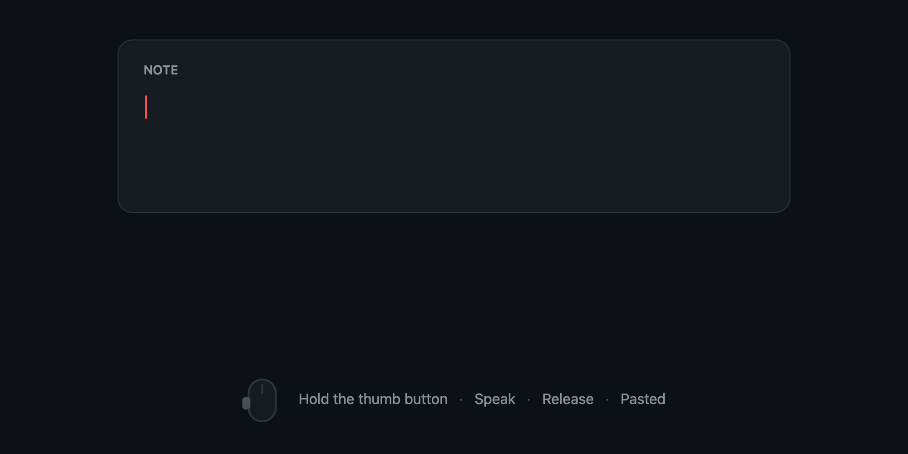

<p align="center">
  
</p>

<p align="center">
  <b>Local push-to-talk dictation for Linux, Windows 11 and macOS.</b><br>
  Hold a button, speak, release. Your words land in whichever text field has focus.
</p>

<p align="center">
  <a href="https://github.com/MrTorriz/sayit/actions/workflows/ci.yml"></a>
  <a href="https://github.com/MrTorriz/sayit/releases/latest"></a>
  <a href="LICENSE"></a>
  <a href="#installation"></a>
</p>

<p align="center">
  
</p>

Speech is recognised on your own machine by [whisper.cpp](https://github.com/ggml-org/whisper.cpp),
on the GPU through Vulkan or Metal. The default model is
[KB-Whisper](https://huggingface.co/KBLab/kb-whisper-medium), the National
Library of Sweden's Swedish Whisper; any GGML Whisper model and language can
be configured instead. No account, no subscription, no telemetry.

## Highlights

- **Private by design.** Audio never leaves the machine. The model server
  listens on `127.0.0.1` only, and after installation recognition works offline.
- **Works where you type.** Terminals, editors, browsers and chat windows. The
  text arrives in one paste, not as a stream of synthetic keystrokes.
- **Ready when you are.** The model stays loaded between dictations while the
  microphone stays closed. On an Apple M6, KB-Whisper large returns a typical
  sentence in about a second.
- **Clear feedback.** A small pill shows a live waveform while the microphone
  is open, and only then; on macOS it then sweeps until the text is pasted.
  All three platforms draw it from the same geometry.
- **Learns your vocabulary.** A wordlist fixes recurring mistakes
  (`sayit-learn "get hub" "GitHub"`), and a local history keeps what you
  dictated, with speaking-speed statistics.
- **Optional Turbo engine.** On Intel graphics, Linux and Windows can switch to
  Whisper large-v3-turbo on OpenVINO with one command, and back again.

## How it works

<p align="center">
  
</p>

Every stage is a small program that can be run and tested on its own: bash
scripts on Linux and macOS, PowerShell with compiled C# helpers on Windows,
and three small Swift programs for the parts macOS insists on doing natively.
A warm local server answers each dictation, and a one-shot `whisper-cli` run
takes over if it ever stops responding. The [architecture guide](docs/ARCHITECTURE.md)
covers the design decisions in depth.

## Installation

sayit installs from source: you need a terminal, native build tools and room
for the model files. Each platform has a full guide; the short version follows.

### Linux

```bash
git clone https://github.com/MrTorriz/sayit.git
cd sayit
./install.sh
./bin/test-pipeline
```

The installer builds whisper.cpp, downloads the models and creates `.env`.
Then set up a trigger: a mouse button through Solaar, or a global shortcut.
KWin/Plasma also needs `ydotoold` for text injection.
**[Linux guide](docs/INSTALL-LINUX.md)**: requirements, triggers, Wayland,
Bluetooth headsets and automatic startup.

### Windows 11

```powershell
git clone https://github.com/MrTorriz/sayit.git
cd sayit
.\win\install.ps1
.\win\sayit-doctor.ps1
```

The installer checks the build tools, builds whisper.cpp and offers to
register a logon task. **Download the two base model files separately**, as
the guide explains. Mouse 5 is the default hold-to-talk button; some mice need
their thumb button mapped in the vendor's utility before Windows can see it.
**[Windows guide](docs/INSTALL-WINDOWS.md)**: prerequisites, model links,
microphone selection, autostart and platform limits.

### macOS

```bash
git clone https://github.com/MrTorriz/sayit.git
cd sayit
./install.sh
./bin/test-pipeline
```

The installer uses Homebrew, builds whisper.cpp with Metal, downloads the
large model on Apple Silicon, builds the `Sayit.app` menu bar agent and loads
its LaunchAgents. Allow Microphone and Accessibility when macOS asks. F18 is
the default trigger: hold it to talk, or tap to start and tap again to stop.
**Probe Trigger** in the menu shows what any key or mouse button sends; a
Logitech button needs a plain mouse-button action in Logi Options+, which the
guide explains. Requires macOS 14 or later; Apple Silicon is recommended.
**[macOS guide](docs/INSTALL-MACOS.md)**: permissions, triggers, the
indicator, the LaunchAgents and platform limits.

### Optional Turbo engine

Linux and Windows only. Complete the base installation first, then follow the
[OpenVINO guide](docs/OPENVINO.md): an isolated Python runtime, compatible
hardware, model verification and the way back.

| Platform | Switch to Turbo | Back to whisper.cpp |
| --- | --- | --- |
| Linux | `./bin/sayit-engine fast` | `./bin/sayit-engine accurate` |
| Windows | `.\win\sayit-engine.ps1 fast` | `.\win\sayit-engine.ps1 accurate` |

The choice persists across logins. The names select engines; they do not
promise which one recognises a given sentence best.

## Platform overview

| | Linux | Windows 11 | macOS |
| --- | --- | --- | --- |
| Engine | whisper.cpp, Vulkan | whisper.cpp, Vulkan | whisper.cpp, Metal |
| Default model | KB-Whisper medium | KB-Whisper medium | KB-Whisper large on Apple Silicon |
| Optional Turbo | OpenVINO on Intel graphics | OpenVINO on Intel graphics | Not offered; large is fast on Metal |
| Trigger | A mouse button via Solaar, or a global shortcut | Mouse 5, or another button or key | F18, or any key or mouse button |
| Text delivery | `ydotool`, `wtype` or `xdotool` | Typing for short text, paste for long | `Cmd+V`, previous clipboard restored |
| Starts at login | systemd user services | Logon task | LaunchAgents |

## Everyday commands

| Task | Linux and macOS | Windows |
| --- | --- | --- |
| Toggle recording | `./bin/sayit` | `.\win\sayit.ps1` |
| Discard recording | `./bin/sayit cancel` (Escape on macOS) | `.\win\sayit.ps1 cancel` |
| Check installation | `./bin/sayit doctor` | `.\win\sayit-doctor.ps1` |
| Show history | `./bin/sayit-history` | `.\win\sayit-history.ps1` |
| Show statistics | `./bin/sayit-history --stat` | `.\win\sayit-history.ps1 -Stat` |
| Teach a replacement | `./bin/sayit-learn "get hub" "GitHub"` | `.\win\sayit-learn.ps1 "get hub" "GitHub"` |

The installation guides cover manual start and stop and indicator placement;
[Configuration](docs/CONFIGURATION.md#custom-wordlist) explains the wordlist
rules, models, languages and accuracy settings.

## Performance

Measured, not estimated. On a Mac mini with an Apple M6, thirty Swedish FLEURS
sentences went through the same warm server and flags that sayit uses:

| Model | Mean per sentence | Word error rate |
| --- | ---: | ---: |
| KB-Whisper large q5_0 (the macOS default) | 1.05 s | 5.2% |
| KB-Whisper medium q5_0 | 0.64 s | 6.4% |
| Whisper large-v3-turbo q5_0 | 0.52 s | 8.4% |

Two optional settings trade a little accuracy for speed. On 423 FLEURS clips
greedy decoding (`BEAM=1`) took the median from 0.92 to 0.77 s and an encoder
window sized to the clip (`AUDIO_CTX_ADAPTIVE=1`) on top to 0.49 s, for a word
error rate of 5.73% instead of 5.38%.

[Performance](docs/PERFORMANCE.md) has the Linux and Windows measurements, the
hardware, the method and the limits of each number. Engine timings are kept
apart from the full button-to-text delay, and small samples are not presented
as general accuracy rankings.

## Limits

Text injection depends on the desktop and the application. Windows cannot
inject into an elevated window from a normal user process, and its indicator
cannot appear over exclusive fullscreen or the UAC secure desktop. Linux
Wayland needs the injection tools described in its guide. On macOS, Secure
Input (a password field, for example) hides keyboard triggers, and a blocked
paste leaves the text on the clipboard.

The model and its helpers stay running between dictations, which costs memory.
Transcription still takes a moment after release, longer for long recordings.

## Privacy

Audio is processed locally and recordings are temporary files, removed after
processing. Dictated text is kept in a local history file, and delivery can
pass through the clipboard. The [security guide](SECURITY.md) lists storage
paths, retention, clipboard handling and what diagnostics may reveal.

An optional text-cleanup step on Linux and macOS (`LLM_CLEANUP=1`, off by
default) sends the transcribed text to `LLM_URL`, a local Ollama by default.
Pointing it at a remote HTTP address sends text to that host unencrypted.

## Documentation

| Guide | Contents |
| --- | --- |
| [Linux installation](docs/INSTALL-LINUX.md) | Setup and everyday use on Linux |
| [Windows installation](docs/INSTALL-WINDOWS.md) | Setup and everyday use on Windows 11 |
| [macOS installation](docs/INSTALL-MACOS.md) | Setup, permissions and everyday use on macOS |
| [Optional Turbo engine](docs/OPENVINO.md) | OpenVINO installation, switching and recovery |
| [Configuration](docs/CONFIGURATION.md) | Settings, models, languages and wordlists |
| [Troubleshooting](docs/TROUBLESHOOTING.md) | Symptoms, checks and fixes |
| [Performance](docs/PERFORMANCE.md) | Measurements and their limits |
| [Architecture](docs/ARCHITECTURE.md) | Pipelines, components and design decisions |
| [Security](SECURITY.md) | Data handling and private vulnerability reports |

## Contributing

Bug reports, measurements from other hardware and pull requests are welcome.
CI runs shellcheck and syntax checks, the bats suites on Linux and macOS, the
Swift and Pester tests and the OpenVINO server tests; capture, inference and
desktop interaction still need a human with a microphone.
[Contributing](CONTRIBUTING.md) explains the layout, the checks and how to
send a change, and the [changelog](CHANGELOG.md) lists what changed when.

## Acknowledgements

sayit stands on [whisper.cpp](https://github.com/ggml-org/whisper.cpp),
[KBLab's KB-Whisper](https://huggingface.co/KBLab), the original
[Whisper](https://github.com/openai/whisper) models,
[OpenVINO](https://github.com/openvinotoolkit/openvino),
[Silero VAD](https://github.com/snakers4/silero-vad) and
[Solaar](https://github.com/pwr-Solaar/Solaar).

## License

[MIT](LICENSE).
