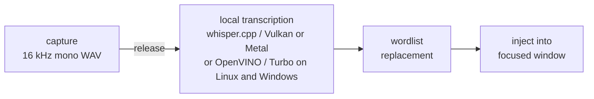
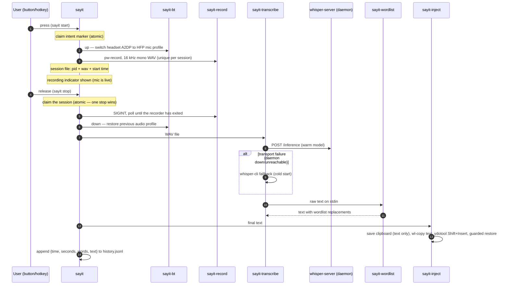
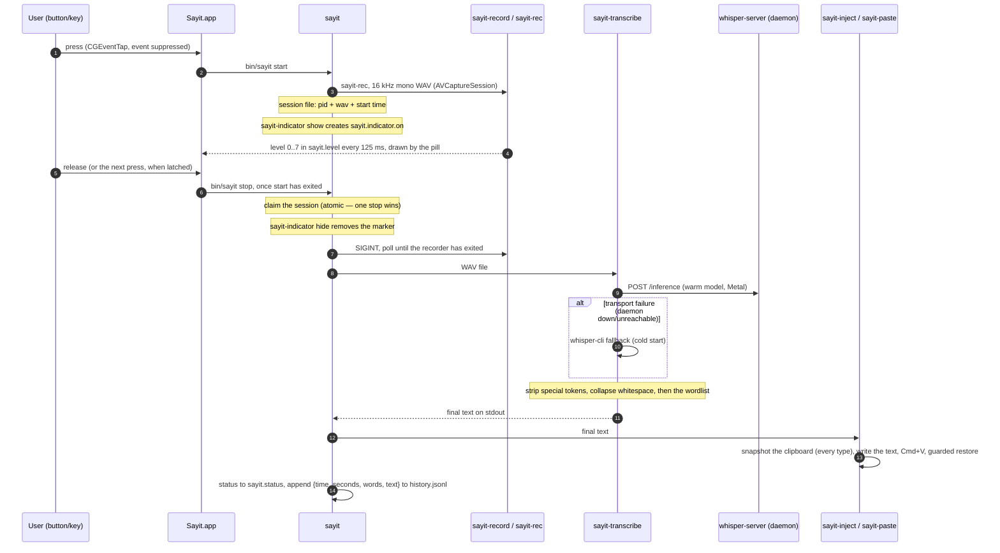

[← README](../README.md) · [Install: Linux](INSTALL-LINUX.md) · [Windows](INSTALL-WINDOWS.md) · [macOS](INSTALL-MACOS.md) · [Configuration](CONFIGURATION.md) · [Troubleshooting](TROUBLESHOOTING.md) · [Performance](PERFORMANCE.md) · **Architecture**

# Architecture

- [One repository, three platforms](#one-repository-three-platforms)
- [The Linux pipeline](#the-linux-pipeline)
- [The Windows pipeline](#the-windows-pipeline)
- [The macOS pipeline](#the-macos-pipeline)
- [Performance and latency](#performance-and-latency)
- [Design decisions](#design-decisions)
- [Deliberate non-goals](#deliberate-non-goals)

sayit is one pipeline with two implementations on three platforms: a set of
small bash scripts in `bin/` for Linux and macOS, and a set of PowerShell
scripts with runtime-compiled C# helpers in `win\` for Windows 11. On macOS the
bash scripts are joined by three small Swift programs in `mac/`, for the parts
where the platform demands its own API: the trigger and the pill, capture, and
text delivery. Each stage can be run and tested on its own; `bin/sayit` and
`win\sayit.ps1` are the orchestrators that wire the stages together and manage
per-session recording state.

All three platforms use the same four stages; Linux can select a different transcription engine:



## One repository, three platforms

### What is shared

| Shared | Contract |
|---|---|
| **Model handling** | The base engine uses pinned whisper.cpp, GGML Whisper and Silero VAD. Linux and Windows can substitute the OpenVINO server; macOS runs whisper.cpp on Metal. Every platform uses the local daemon first and `whisper-cli` on HTTP/transport failure; an empty successful response is final |
| **Wordlist format** | `original<TAB>replacement`; rules sorted by original length descending, applied sequentially and globally, case-insensitive on Unicode word boundaries, originals treated as literal strings rather than regexes |
| **History format** | `history.jsonl`, one JSON object per line: `time` (local ISO-8601 to seconds), `seconds`, `words`, `text`. Same field names, order and types, so a history file is portable between the platforms |
| **Settings** | One `.env` from one `.env.example`. A setting that exists on more than one platform has the same name and the same meaning; the file carries a clearly marked Windows section and a macOS section at the end. `Sayit.app` deliberately reads the Windows names for the trigger and the indicator |
| **Diagnostics discipline** | A separate read-only `doctor` command on each platform; error logs record error *classes*, never dictated text; profiling records timings, never text |
| **Documentation and identity** | Shared documentation and logo. Every platform shows a 26-bar recording waveform without a lamp or wordmark; Windows also omits the outline. Optional resident views retain the lamp and wordmark. `docs/check-geometry.py` checks the Windows and macOS copies of the shared geometry against the Linux overlay; `docs/build-logo.py` generates the logo from the resident design |

### Where they diverge, and why

Linux and macOS share their code: both are POSIX systems on which the same bash
scripts run, and `bin/` branches on `$OSTYPE` only where Darwin differs. macOS
adds Swift exactly where no shell tool can do the job — an event tap,
AVFoundation capture and the pasteboard. Windows shares no code with either,
because there is nothing to share: bash, PipeWire, ydotool, systemd and
layer-shell on one side; PowerShell 5.1, `waveIn`, `SendInput`, Task Scheduler
and WinForms on the other. Every divergence below is forced by the platform,
not chosen for taste.

| Stage | Linux | Windows | macOS | Why they cannot be the same |
|---|---|---|---|---|
| Capture | `pw-record` | `waveIn` via `lib\Recorder.cs` | `sayit-rec`: `AVCaptureSession`, converting to 16 kHz mono 16-bit itself | There is no PipeWire on Windows or macOS. `waveIn` is a shim over the shared-mode audio engine, so 16 kHz mono 16-bit comes back resampled by the engine with no COM interop. On macOS no shell tool records from a chosen Core Audio device in that format, and the capture must belong to `Sayit.app` to run under its microphone grant |
| Stopping the recorder | `SIGINT`, then poll until the process has exited so the WAV header is finalized | signal a named event; the recorder writes its own final RIFF header before exiting | as on Linux — `bin/sayit` is the same script. `sayit-rec` also rewrites its header about once a second and finalizes it on `SIGINT`, `SIGTERM` or `SIGHUP` | Windows has no SIGINT equivalent for another process. An event is cleaner anyway: a truncated WAV stops being a failure mode. macOS has signals, so the shared path stands |
| Trigger | Solaar rules (mouse) or a desktop global shortcut invoking `bin/sayit` | `WH_KEYBOARD_LL` and `WH_MOUSE_LL` in-process | one session `CGEventTap` in `Sayit.app`, which runs `bin/sayit start`/`stop`/`cancel` | Windows has no Solaar-equivalent rule engine. Of the Windows input APIs, only low-level hooks give both press and release for mouse side buttons *and* can suppress the event. On macOS an active event tap is the equivalent, and Solaar does not exist there |
| Injection | clipboard + `Shift+Insert` via `ydotool`, with `wtype`/`xdotool` fallbacks | `SendInput` with `KEYEVENTF_UNICODE`, clipboard + `Ctrl+V` above a threshold | `sayit-paste`: clipboard + `Cmd+V`, the whole previous clipboard restored; Unicode typing on request | `ydotool` sends US scan codes, so non-ASCII breaks; `KEYEVENTF_UNICODE` sends the character itself and is layout independent by construction. On macOS `Cmd+V` works in every application, while Unicode key events are not honoured by all |
| Feedback | a persistent notification, plus a meter that opens its own capture stream | one layered click-through window, fed by the level the recorder already computed | `Sayit.app`'s pill, fed by the level `sayit-rec` publishes, and a menu bar item; no notifications | Windows has no notification server to hold a persistent notification against, and no second capture stream is needed when the recorder can publish the level. macOS's Notification Center keeps every notification, dictated snippets included |
| Warm model | a systemd user service | `sayit-autostart.ps1`, started by a scheduled task at logon, or `sayit-daemon.ps1 start` by hand | a LaunchAgent, `io.github.mrtorriz.sayit.daemon` | No systemd |
| Keeping the trigger alive | systemd `Restart=` | `sayit-autostart.ps1` supervises it; the task's repeating trigger supervises the supervisor | the agent's LaunchAgent restarts `Sayit.app` after a crash | The task scheduler's own `RestartOnFailure` was measured not to fire for this process, and a task cannot see inside its own instance. launchd's `KeepAlive` does the job systemd does |
| Bluetooth | `bin/sayit-bt` switches A2DP to HFP and restores it | nothing | nothing — `bin/sayit-bt` exits at once | Windows and macOS select the headset's call profile themselves when an application opens its microphone. On Windows the whole stage, its state file and the intent marker that covered the switch window are absent; on macOS the shared script keeps the marker, which then covers only a start that is still spawning its recorder |
| Transient state | `$XDG_RUNTIME_DIR`, RAM-backed and wiped at logout | `%LOCALAPPDATA%\sayit\run`, on disk | the per-user temporary directory (`getconf DARWIN_USER_TEMP_DIR`), mode 0700, on disk | Neither Windows nor macOS has a per-user tmpfs, so cleanup is explicit: the WAV is deleted after transcription and stale WAVs older than an hour are swept at the next start. On Windows `sayit-doctor.ps1` reports whatever is left |
| Config parsing | `.env` is sourced as bash | `.env` is parsed as `KEY=VALUE` data | sourced as bash by the scripts; parsed as `KEY=VALUE` data by `Sayit.app` | Running arbitrary code from a config file is a worse trade on any platform, and nothing in `.env.example` needs it. The Windows reader expands `%VAR%` and nothing else; Sayit's expands `$HOME` and nothing else. On macOS the bash scripts are Linux's, so they source the file as Linux does |

## Optional Linux transcription engine

`bin/sayit-openvino` reads `.env` and starts `engines/openvino/server.py` using
an isolated virtual environment. The server loads Whisper large-v3-turbo into
OpenVINO and uses the installed libwhisper for Silero VAD on CPU. Silero gates
whole recordings instead of cutting segments. A single HTTP worker serializes
both model states. `/health` identifies the engine after warm-up; `/inference`
accepts Sayit's multipart WAV requests and returns text or an empty success.

`bin/sayit-engine` manages one user-service override. A shared file lock held by
recording/transcription prevents switching during dictation. Failed startup
restores the prior override; successful selection enables the service at login.
The existing CLI remains a local fallback. [Details and limits](OPENVINO.md).

## The Linux pipeline



### Components

| Script | Single responsibility |
|---|---|
| `sayit` | Session state machine: toggle/hold/cancel, atomic session claiming, PID identity checks, notifications, history |
| `sayit-bt` | Bluetooth headset profile switching (A2DP has no mic channel) |
| `sayit-doctor` | Read-only diagnostics: resolves `AUDIO_SOURCE` against live nodes, explains a missing source, reports the Bluetooth profile and leftover state |
| `sayit-record` | Audio capture only — PipeWire to 16 kHz mono WAV |
| `sayit-daemon` | Starts `whisper-server` from `.env` so the model stays warm in RAM |
| `sayit-transcribe` | Model I/O: daemon first, CLI fallback on transport errors, token cleanup, optional LLM pass |
| `sayit-wordlist` | Pure text transform: stdin to stdout, TSV rules (unit-tested) |
| `sayit-inject` | Text delivery with a fallback chain per compositor, clipboard hygiene |
| `sayit-indicator` | Persistent recording indicator (notification-based, safe fallbacks) |
| `sayit-meter` | Live voice meter: picks a style, owns the capture stream and its cleanup; feedback only |
| `sayit-overlay` | The overlay style — sayit's own click-through pill, drawn through layer-shell (the one Python script). `--resident` keeps it up for the whole session |
| `sayit-history` | Read side of `history.jsonl`: listing, stats, re-inject; corrupt-line tolerant |
| `sayit-learn` | Write side of the wordlist: add/undo/list with dedup |

### Runtime state

All transient state lives in `$XDG_RUNTIME_DIR` (RAM-backed tmpfs, wiped at
logout); only history and the wordlist persist.

| Path | Purpose |
|---|---|
| `$XDG_RUNTIME_DIR/sayit.session` | One line: `pid<TAB>wav<TAB>start`. Presence means "recording". Claimed atomically (mv) by stop/cancel, so concurrent invocations cannot double-process a session |
| `$XDG_RUNTIME_DIR/sayit.starting` | Intent marker while `start` is still switching the Bluetooth profile; lets a quick release wait instead of giving up |
| `$XDG_RUNTIME_DIR/sayit-<pid>.wav` | The recording in progress — unique per session, so back-to-back dictations never overwrite each other |
| `$XDG_RUNTIME_DIR/sayit.bt` | Card name + previous audio profile, written by `sayit-bt up`, consumed by `down` (explains the "stuck in phone-quality audio" failure mode) |
| `$XDG_RUNTIME_DIR/sayit.indicator` | Notification ID of the visible recording indicator |
| `$XDG_RUNTIME_DIR/sayit.meter` | PID of the running meter — identity-checked against its command line before it is ever signalled |
| `$XDG_RUNTIME_DIR/sayit-last-error.log` | Error classes from failed stages (never dictated text) |
| `$XDG_RUNTIME_DIR/sayit-profile.csv` | Per-stage timestamps when `SAYIT_PROFILE=1` (timing data only) |
| `$XDG_DATA_HOME/sayit/history.jsonl` | One JSON object per dictation |
| `$XDG_CONFIG_HOME/sayit/wordlist.tsv` | User vocabulary, grown by `sayit-learn` |
| `$XDG_RUNTIME_DIR/sayit.overlay` | FIFO a resident overlay reads its audio from; `sayit-meter` writes the capture stream here instead of starting a second pill |
| `$XDG_RUNTIME_DIR/sayit.overlay.pid` | PID of the resident overlay — identity-checked before it is written to or signalled |
| `$XDG_CONFIG_HOME/sayit/overlay-position` | Where the overlay pill sits, written by `sayit-overlay --place` |

PIDs read back from state files are trusted only after an identity check:
the process's command line must name the session's own (unique) WAV path,
so a recycled PID — even another recorder — is never signalled.

## The Windows pipeline

The optional `engines/openvino/server.py` serves the same local HTTP protocol
as whisper-server. `win/lib/engine.ps1` owns launch, health checking, engine
selection and rollback. `%APPDATA%\sayit\engine-mode` persists only a successful
selection, and `%LOCALAPPDATA%\sayit\run\engine-process.json` records process
identity for safe shutdown. A shared file lease allows overlapping dictations
but excludes an engine switch until they finish. The existing scheduled task
starts the selected engine; HTTP failure still uses the native CLI fallback.

```mermaid
sequenceDiagram
    autonumber
    participant U as User (button/hotkey)
    participant TR as sayit-trigger.ps1
    participant S as Warm STA worker
    participant R as WarmCapture / waveIn
    participant IN as sayit-indicator.ps1
    participant T as lib/transcribe.ps1
    participant D as Local engine (native or Turbo)

    U->>TR: press (WH_MOUSE_LL / WH_KEYBOARD_LL, event suppressed)
    TR->>R: start capture thread (16 kHz mono WAV)
    Note over TR: save unique session and named stop event
    R-->>TR: microphone ready
    TR->>IN: show
    R-->>IN: level 0..7 through the run directory
    U->>TR: release
    TR->>R: signal stop; finalize RIFF header
    TR->>IN: hide
    Note over TR: claim the session atomically
    TR->>S: queue completed recording in order
    S->>R: wait for capture completion
    S->>T: WAV file
    T->>D: POST /inference (warm model)
    alt transport failure (daemon down/unreachable)
        T->>T: whisper-cli fallback (cold start)
    end
    Note over T: strip special tokens, collapse whitespace, then the wordlist
    T-->>S: final text
    Note over S: inject in-process — SendInput Unicode, or clipboard + Ctrl+V
    S->>S: append {time, seconds, words, text} to history.jsonl
```

### Components

| Script | Single responsibility |
|---|---|
| `sayit.ps1` | Session state machine: toggle/hold/cancel, atomic session claiming, history. Injects in-process |
| `sayit-trigger.ps1` | The push-to-talk hook: binds one button, optionally suppresses it, and runs `start`/`stop`. `-Probe` reports transitions without binding or suppressing anything |
| `sayit-rawprobe.ps1` | Diagnostic only: Raw Input observation for buttons that report as HID consumer-control usages rather than as mouse buttons |
| `sayit-record.ps1` | Audio capture only — `waveIn` to 16 kHz mono WAV, stopped by a named event, capped by `MAX_RECORD_SECONDS`. Also publishes the level and reports a digitally silent capture |
| `sayit-daemon.ps1` | Starts, stops and probes the selected native or Turbo engine so the model stays warm |
| `sayit-transcribe.ps1` | Model I/O: daemon first, CLI fallback on transport errors, token cleanup, wordlist |
| `sayit-wordlist.ps1` | Command-line front end to the wordlist engine in `lib\common.ps1` |
| `sayit-inject.ps1` | Text delivery front end for manual use and for `sayit-history.ps1 -Inject` |
| `sayit-indicator.ps1` | The on-screen pill: `show`, `hide`, `place`. Feedback only |
| `sayit-doctor.ps1` | Read-only diagnostics: backend, models, daemon, capture devices, resolved settings, leftover state, platform limits |
| `sayit-history.ps1` | Read side of `history.jsonl`: listing, stats, copy, re-inject; corrupt-line tolerant |
| `sayit-learn.ps1` | Write side of the wordlist: add/undo/list with dedup |
| `sayit-autostart.ps1` | Supervisor: starts the daemon without waiting, holds the trigger up, restarts it when it exits or stops answering, and cancels a recording an abnormal exit left behind |
| `install.ps1` | Prerequisites, the pinned whisper.cpp build, the model check, `.env`, the wordlist seed and the optional logon task |

| Helper | Responsibility |
|---|---|
| `lib\common.ps1` | Paths, `.env` reader, UTF-8 file IO without a BOM, stage profiling, the wordlist engine, the C# source merger, the error log |
| `lib\inject.ps1` | The injection decision: elevated-target check, method by length, clipboard fallback |
| `lib\transcribe.ps1` | The transcription itself: the daemon request, the CLI fallback, token cleanup and the wordlist call — dot-sourced so no second PowerShell is spawned |
| `lib\Recorder.cs` | `waveIn` capture, the RIFF writer, peak tracking and level publishing, device enumeration and resolution |
| `lib\WarmCapture.cs` | Per-recording native thread in the trigger host, with ready, stop and completion events |
| `lib\transcription-worker.ps1` | Reusable STA runspace for ordered transcription and text delivery without per-release process startup |
| `lib\Trigger.cs` | The low-level keyboard and mouse hooks, the event queue and the injection signature |
| `lib\Injector.cs` | `SendInput` Unicode typing, the clipboard with its history and cloud opt-outs, the paste chord, the integrity-level check |
| `lib\RawInput.cs` | Raw Input registration and decoding for the diagnostic probe |

The C# helpers are compiled at runtime by `Add-Type` using the in-box compiler,
so they are kept to C# 5 syntax — Windows PowerShell 5.1 supports no later
language version. `Injector.cs` references a constant from `Trigger.cs`, so the
two must be compiled together; `Merge-CSharpSources` hoists every `using`
directive to the top before concatenating, because the naive concatenation is
invalid C#. CI compiles the helpers for exactly this reason: a syntax error
in them would otherwise only surface on a user's machine.

### Runtime state

Windows has no RAM-backed equivalent of `$XDG_RUNTIME_DIR`, so transient state
lives on disk under `%LOCALAPPDATA%\sayit\run` and is cleaned up explicitly.

| Path | Purpose |
|---|---|
| `%LOCALAPPDATA%\sayit\run\sayit.session` | One line: `pid<TAB>wav<TAB>start<TAB>stop-event-name`. Presence means "recording". Claimed by an atomic rename, so exactly one stop or cancel wins |
| `%LOCALAPPDATA%\sayit\run\sayit-<id>.wav` | The recording in progress — unique per session. Deleted after transcription; stragglers older than an hour are swept when the next recording starts |
| `%LOCALAPPDATA%\sayit\run\level` | The current level, `0`–`7`, written by the recorder and read by the indicator |
| `%LOCALAPPDATA%\sayit\run\indicator.on` | Presence means the indicator should be visible; removing it hides the window while its process stays ready |
| `%LOCALAPPDATA%\sayit\run\engine-process.json` | Engine process identity: PID, executable and start time, checked before stopping its process tree |
| `%APPDATA%\sayit\engine-mode` | Persisted native (`accurate`) or Turbo (`fast`) selection for the next logon |
| `%LOCALAPPDATA%\sayit\run\sayit-last-error.log` | Error classes from failed stages (never dictated text). Unlike its Linux counterpart it survives logout |
| `%LOCALAPPDATA%\sayit\run\sayit-profile.csv` | Per-stage timestamps when `SAYIT_PROFILE` is set (timing data only) |
| `%LOCALAPPDATA%\sayit\run\trigger-probe.log`, `rawprobe.log` | Transcripts of the two diagnostic probes: button transitions, never text |
| `%LOCALAPPDATA%\sayit\history.jsonl` | One JSON object per dictation |
| `%APPDATA%\sayit\wordlist.tsv` | User vocabulary, grown by `sayit-learn.ps1` |
| `%APPDATA%\sayit\overlay-position` | Where the pill sits, written by `sayit-indicator.ps1 place` |

The stop path does not depend on the recorded PID being the right process: it
signals the session's own named event, which no other session can be waiting on.
Warm capture waits for its completion event and never kills the shared trigger
host to stop one recording. The standalone CLI recorder retains its separate
process and identity-checked termination fallback. `sayit-doctor.ps1` identifies recorders by
command line instead, which is how it distinguishes an orphan from the live
session's own recorder.

## The macOS pipeline



### Components

| Component | Single responsibility |
|---|---|
| `Sayit.app` | The menu bar agent: the push-to-talk event tap, the pill, the menu and the permission prompts. Runs `bin/sayit start`, `stop` and `cancel`; records and pastes nothing itself |
| `sayit-rec` | Audio capture only — `AVCaptureSession` to 16 kHz mono WAV. Also publishes the level, enforces `MAX_RECORD_SECONDS` and reports a digitally silent capture. `--list` and `--resolve` serve diagnostics |
| `sayit-paste` | Text delivery: clipboard plus `Cmd+V` with the whole previous clipboard restored, or Unicode typing. `--check` reports Accessibility and Secure Input |
| `mac/install.sh` | Builds the three with `swiftc`, signs and installs the bundle, writes and loads the two LaunchAgents; `--uninstall` |
| `mac/sayit-doctor` | Read-only diagnostics. `bin/sayit-doctor` hands over to it on macOS |
| `bin/*` | The Linux scripts in the same roles. Their Darwin branches: `sayit` writes its status to a file instead of notifying and checks recorder identity with `ps`; `sayit-record` execs `sayit-rec`; `sayit-inject` hands the text to `sayit-paste`; `sayit-indicator` creates and removes a marker file; `sayit-bt` exits at once; `sayit-daemon` and `sayit-transcribe` prefer the large model on Apple Silicon; `sayit-history --copy` uses `pbcopy`; `test-pipeline` synthesises with `say` |

| Source | Holds |
|---|---|
| `mac/Sources/Agent/main.swift` | Sayit's entry point, and `--probe` |
| `mac/Sources/Agent/AppDelegate.swift` | The menu bar item, the status line, permission prompts, Reload Settings, the `sayit.agent` status file |
| `mac/Sources/Agent/Config.swift` | Sayit's settings from `.env`, and the `TRIGGER_BUTTON` grammar |
| `mac/Sources/Agent/Trigger.swift` | The event tap: the three modes, Escape, the modifier rule, the own-event signature |
| `mac/Sources/Agent/Pill.swift` | The pill's two lifetimes, its position file and its animation |
| `mac/Sources/Agent/Runner.swift` | Spawns `bin/sayit`; a stop waits for its start to have exited |
| `mac/Sources/Rec/main.swift` | `sayit-rec` |
| `mac/Sources/Paste/main.swift` | `sayit-paste` |
| `mac/Sources/Common/Shared.swift` | The run directory, the `.env` reader and atomic writes, shared by all three programs |
| `mac/Sources/Common/PillGeometry.swift` | The pill's geometry, colours and level thresholds, compiled into both `Sayit` (which draws) and `sayit-rec` (which computes the level) |

### Runtime state

macOS has no `$XDG_RUNTIME_DIR`. The run directory is the per-user temporary
directory that `getconf DARWIN_USER_TEMP_DIR` names — normally the same
directory as `$TMPDIR` — unless `XDG_RUNTIME_DIR` is set, in which case that
wins everywhere. The bash scripts compute and export it; `Sayit.app` passes the
same path to every command it starts, so both sides always agree.

| Path | Purpose |
|---|---|
| `$RUN_DIR/sayit.session` | As on Linux: `pid<TAB>wav<TAB>start`, claimed atomically. Sayit also reads its presence to decide whether a press on a latched recording means stop or start |
| `$RUN_DIR/sayit.starting` | Intent marker while `start` is still spawning the recorder |
| `$RUN_DIR/sayit-<pid>.wav` | The recording in progress, mode 0600, unique per session. Deleted after transcription; stragglers older than an hour are swept when the next recording starts |
| `$RUN_DIR/sayit.indicator.on` | Presence means the pill should show a recording. Created and removed by `bin/sayit-indicator show` and `hide` |
| `$RUN_DIR/sayit.level` | One digit, `0`–`7`, rewritten in place by `sayit-rec` every 125 ms. Its modification time is the "audio is arriving" signal. Removed when the recording ends |
| `$RUN_DIR/sayit.status` | The last status `bin/sayit` reported, shown as the first line of Sayit's menu. A `Done` status loses its text on the way |
| `$RUN_DIR/sayit.agent` | Kept current by Sayit, rewritten whenever it changes: its pid, the repository, both permissions, the resolved trigger, the mode and the indicator lifetime. What the doctor reads; never text. Removed when Sayit quits |
| `$RUN_DIR/trigger-probe.log` | Probe Trigger's transcript: button and modifier transitions, and the codes of keys that type no character or are pressed with `Cmd` or `Ctrl` — never text. Started afresh by each probe and never removed |
| `$RUN_DIR/sayit-paste.lock` | Held by `sayit-paste` from its clipboard snapshot until its restore, so two quick pastes take turns |
| `$RUN_DIR/sayit-last-error.log` | Error classes from failed stages and the recorder's stderr, including the silent-capture report (never dictated text) |
| `$RUN_DIR/sayit-profile.csv` | Per-stage timestamps when `SAYIT_PROFILE=1` (timing data only). Uptime comes from `kern.boottime`, as there is no `/proc/uptime` |
| `~/.local/share/sayit/history.jsonl` | One JSON object per dictation — `$XDG_DATA_HOME`, as on Linux |
| `~/.config/sayit/wordlist.tsv` | User vocabulary, grown by `sayit-learn` — `$XDG_CONFIG_HOME`, as on Linux |
| `~/.config/sayit/overlay-position` | Where the pill sits, in the Linux file format: points from the top-left corner of the main screen |
| `~/Library/Logs/sayit/daemon.log`, `agent.log` | `whisper-server`'s output, and the stderr of Sayit and the commands it starts |

The Linux-only state — `sayit.bt`, `sayit.indicator`, `sayit.meter` and the
resident overlay's FIFO — never appears on macOS. The PID identity check is the
Linux one: macOS has no `/proc`, but `ps -o command=` reports the same command
line, and `sayit-rec`'s names the session's own WAV.

## Performance and latency

All measured numbers live in one place: [PERFORMANCE.md](PERFORMANCE.md). It
carries all three reference machines, the methods, the dates and — explicitly —
what is measurement, what is estimate and what is arithmetic.

Two facts from it shape the design and belong here:

- **The warm daemon removes the per-dictation model load entirely.** That is the
  whole reason the daemon-first contract exists, and why the CLI fallback is
  reserved for transport failures rather than used as a peer.
- **A daemon request times out after `audio seconds + 10 s`, with a 2 s connect
  timeout.** A deadline that scales with the audio is what keeps a wedged server
  from stalling a short dictation: the request gives up and the CLI fallback
  finishes the job. `tests/transcribe.bats` asserts that the deadline scales.

Not covered by any harness: microphone capture, the Bluetooth profile switch on
Linux, and the switch macOS makes by itself when capture opens a headset's
microphone. The Linux switch happens synchronously at press time, which is why
the recording indicator is the signal that the microphone is live — not the
button press. On macOS the equivalent signal is the pill's meter starting to
move, or the resident pill's lamp lighting, both of which follow audio actually
arriving.

Per-stage timings of real dictations: run with `SAYIT_PROFILE=1` and read the
CSV in the run directory. Run id, wall clock, monotonic uptime, stage and a
numeric extra — never text.

## Design decisions

### Shared

#### Warm daemon with cold-start fallback

whisper.cpp spends noticeable time per invocation just loading the model. A
`whisper-server` kept running removes that cost entirely (see the measured tables
above) — as a systemd user service on Linux, as a LaunchAgent on macOS, and on
Windows as the first thing `sayit-autostart.ps1` does, itself started by a
scheduled task at logon. It is started without waiting for it, so the
push-to-talk trigger is armed while the model is still loading rather than
after it. Both transcribers — `bin/sayit-transcribe` on
Linux and macOS, `win\sayit-transcribe.ps1` on Windows — try the server first
and fall back to `whisper-cli`
**only on transport failures**: an empty answer from a healthy daemon means "no
speech" and is final, and re-running it on the CLI would spend a second to get
the same answer. The daemon is optional; note the inverse dependency too, on
every platform: `whisper-cli` and the local model file are only required when
the fallback actually runs.

#### VAD plus token suppression

Whisper hallucinates on silence — ghost sentences, repeated phrases, `[music]`
markers. Two layers remove that: Silero VAD filters non-speech audio before the
model sees it, and `-sns` (suppress non-speech tokens) removes bracketed noise
tokens at decode time.

Where VAD *cuts* is tuned identically on every platform, and not at whisper.cpp's
own defaults. A segment ends at the first 32 ms frame whose speech probability
falls below `VAD_THRESHOLD` − 0.15, after which only `VAD_SPEECH_PAD_MS` is added
back; the default 30 ms therefore cuts inside the 80–150 ms a Swedish unvoiced
final (`-t`, `-s`, `-st`, `-rt`) occupies. `VAD_MIN_SILENCE_MS` does not help,
however high it is set — it delays when a segment is closed, not where it ends.
`VAD_MIN_SPEECH_MS` is a correctness setting rather than a quality one: whisper
discards shorter segments, and when every segment is discarded the transcription
still succeeds, empty and without an error, so a one-word answer can vanish
silently. sayit defaults it to `0`. All four travel with the request on every
platform, so a change applies to the next dictation without a daemon restart.

#### Sequential wordlist, longest rule first

Wordlist rules are applied one substitution per rule, sorted by original
length descending, so a multi-word rule ("get hub" -> "GitHub") always beats a
substring rule ("hub" -> ...), regardless of file order. Matching is
case-insensitive on word boundaries and UTF-8 aware — `på` never matches
inside `påse`. Rules are literal strings, not regexes, so `sayit-learn`
input can never break the pipeline. Because rules run sequentially, a
replacement can itself be matched by a later, shorter rule — keep originals
specific. See `tests/wordlist.bats` and `win\tests\Wordlist.Tests.ps1` for the
exact contract; both suites assert the same behaviour.

#### Per-session state with atomic claiming

Hold-to-talk generates racy event pairs: buttons bounce, and users re-press while
the previous dictation is still transcribing. Every recording therefore gets a
unique WAV and a single session file written atomically; stop and cancel *claim*
the session with an atomic rename, so exactly one consumer wins. A start that
cannot spawn its recorder cleans up and reports — it never leaves state behind.

Linux and Windows differ in what follows the claim. On Linux a release can arrive
while start is still switching the Bluetooth profile, so an intent marker covers
that window and a quick release waits for it instead of giving up; stopping then
sends `SIGINT` and polls until the recorder has exited, so the WAV header is
finalized before it is read, and every signal is preceded by a process-identity
check. On Windows there is no profile switch to cover and therefore no intent
marker, and stopping sets a named event that the recorder itself waits on — the
recorder writes its own final RIFF header, so a half-written file is not a
failure mode there.

macOS runs the Linux script, claim, intent marker, identity check and all. The
identity check reads the command line from `ps` instead of `/proc`, and one
race is closed before it reaches the script: Sayit's runner never spawns a
`stop` or `cancel` until the `start` before it has exited, so a release faster
than the start cannot leave a recording behind with nothing left to stop it.

#### Read-only diagnostics as a separate command

The recording path fails in ways the recorder itself cannot explain. Every
platform therefore ships a `doctor` that answers "why" without changing anything,
as a separate command rather than a flag on the recorder, so that diagnosing a
broken microphone never risks starting a recording and every check stays trivially
auditable as read-only.

On Linux, a node name that no longer resolves looks identical whether the device
is unplugged, renamed, or merely sitting in a card profile that exposes no input;
`pw-record` reports only that the target is gone. `sayit-doctor` resolves
`AUDIO_SOURCE` against the sources PipeWire currently exposes, walks back to the
owning card when that fails, and prints the exact `pactl set-card-profile` line
that would restore an input. The only audio commands it runs are `pactl info`,
`pactl -f json list …` and `pactl get-default-…`; it never issues a `set-` of any
kind — the lines it prints are text for the operator to run.

Every one of its queries is guarded. `pactl`'s JSON writer is not robust — it
emits the literal string `(null)` for a description it cannot encode — and a card
without a `profiles` key makes `jq` exit non-zero. Under `set -e` an unguarded
query would abort the run mid-report: a diagnostic tool dying on the data it was
asked to diagnose, exactly where the diagnosis was most needed.

On Windows, `sayit-doctor.ps1` enumerates capture devices with `waveInGetDevCaps`
only, which reports what the driver exposes without opening the device, and
resolves `AUDIO_SOURCE` exactly the way the recorder does. It also reports what
no other command can tell you at a glance: whether `ggml-vulkan.dll` sits beside
the binaries (the thing that decides whether the build can use the GPU), what
`.sayit-build-info` recorded, whether the daemon answers, stale sessions,
orphaned recorder processes and leftover WAV files. It prints resolved settings
but never `.env` itself, and for `INITIAL_PROMPT` and `SUPPRESS_REGEX` only
whether they are set — both hold text the user wrote.

On macOS the question the doctor most needs to answer is one it cannot ask
directly: the permissions belong to `Sayit.app`, not to the terminal the doctor
runs in, so querying them from there would describe the wrong process. Sayit
therefore writes what it sees — both permissions, whether its event tap is
installed, the resolved trigger — to `sayit.agent` whenever it changes, and
`mac/sayit-doctor` reads that file, after checking that the pid in it really is
Sayit. The rest it can see for itself: the bash version the services will get,
the whisper.cpp backend, the model the daemon will load, both LaunchAgents and
whether the daemon answers, the input devices (`sayit-rec --list`, which
enumerates without opening anything) and what `AUDIO_SOURCE` resolves to, and
whether Secure Input is on. It records nothing, posts no keystroke, touches no
clipboard and loads or unloads nothing.

### Linux

#### Clipboard injection instead of synthetic typing

Typing tools (`ydotool type`) send US-layout keycodes: any non-ASCII character
— `å`, `ä`, `ö`, and even `?` on some layouts — is dropped or wrong. sayit
instead puts the text on the clipboard with `wl-copy` and sends a single
Shift+Insert. That is exact for every language and toolkit. Clipboard hygiene
rules: only a plain-text clipboard is saved and restored (~1 s after pasting,
and only if the clipboard still holds the dictation — a copy the user made in
the meantime is never overwritten); non-text clipboards and clipboards tagged
with a password-manager hint are never read or re-offered; the primary
selection is cleared after the paste window. On compositors where native
typing works, `wtype` (wlroots) and `xdotool` (X11 sessions only) remain as
fallbacks — KWin/Plasma notably does not expose the virtual-keyboard
protocol, which is why the clipboard path is the default.

#### Bluetooth profile juggling

A2DP (the high-quality playback profile) has no microphone channel, so a
Bluetooth headset is silent as an input device until it is switched to its
headset profile (HSP/HFP, mSBC 16 kHz). `sayit-bt` does this switch on record
start and restores the previous profile on stop. The switch is synchronous —
capture begins only after the mic is live, which is why the recording
indicator (rather than the button press) is the "start speaking" cue.
Playback quality dips for exactly the duration of the recording. The headset
is discovered from the default output at runtime, so nothing is hardcoded.

A configured `AUDIO_SOURCE` bypasses this path entirely: a dedicated
microphone is already an input device, so switching a headset that is only
playing audio would trade good playback for a microphone sayit was told not
to use. `sayit` therefore skips `sayit-bt` whenever `AUDIO_SOURCE` is set, and
the headset stays in A2DP for the whole recording.

The state file is written before the switch, not after, so a process killed
mid-switch still leaves `down` able to restore the profile. The mirror case is
handled explicitly: a switch that *fails* removes the record again, because a
profile the card was never taken out of must not be "restored" later.

None of this exists on Windows, which selects HFP itself when an application
opens a capture endpoint.

#### A recording indicator that can never break recording

The indicator is a persistent desktop notification (`notify-send --print-id`,
closed via the standard Notifications D-Bus interface). It appears only once
the microphone is actually capturing — not during the Bluetooth switch — and
is removed on stop, cancel and every failure path. Missing tools or an old
libnotify degrade it to a transient notification or a no-op; it never takes
focus, never blocks injection, and can be disabled with
`RECORDING_INDICATOR=0`.

The live meter takes the same idea further. While recording, `sayit-meter`
opens its own low-rate PipeWire capture (sources allow concurrent readers,
so the recording itself is untouched) and reduces the audio to a single
level about 8 times per second. The meter is the mark's own row of bars:
they follow the voice level. The transient overlay shows a wide meter without
a red lamp or wordmark; its presence already indicates that recording is active.
The samples are used only for that computation; no audio is stored.

Three styles render it, each falling back to the next when its
requirements are missing, so the meter degrades instead of vanishing:

- **`overlay`** (default) — `sayit-overlay` draws sayit's own pill through
  the layer-shell protocol. It owns its appearance rather than borrowing a
  desktop's, and it never takes focus. Whether it takes a click depends on
  which lifetime it has, below: the short-lived one is click-through, the
  resident one is draggable. Either way the position is remembered. Needs
  Wayland with layer-shell and the GTK bindings; without them the meter
  drops to the OSD styles.

  The pill has two possible lifetimes. By default it lives exactly as long
  as the recording that started it, and `sayit-meter` pipes the capture
  stream straight into it. Enabling the `sayit-overlay` user service instead
  runs one `sayit-overlay --resident` for the whole session, and the meter
  writes into that pill's FIFO rather than starting a second one:

  | | Piped (default) | Resident (`sayit-overlay.service`) |
  | --- | --- | --- |
  | On screen | only while recording | the whole session |
  | Contents | wide meter only | lamp, meter and wordmark |
  | Audio inlet | stdin, from the meter's `pw-cat` | `$XDG_RUNTIME_DIR/sayit.overlay`, written by the same `pw-cat` |
  | Recording starts | the process starting is the signal | audio arriving on the FIFO |
  | Recording ends | end of stream ends the process | `AUDIO_IDLE_S` (0.4 s) without audio |
  | At rest | does not exist | the same pill, the same colours; the meter still and the lamp dark |
  | Layer | `OVERLAY`, above fullscreen | `OVERLAY`, in both states |
  | Redraw | ~30 fps | 4 fps at rest, ~30 fps while lit |

  Both lifetimes stay on the `OVERLAY` layer. A resting resident used to
  drop to `TOP` so that it would not cover a fullscreen video, and that cost
  more than it bought: a desktop panel is on `TOP` as well, and stacking
  within a layer follows map order, so a pill parked in the panel's strip was
  visible at rest or hidden behind the panel depending on which surface the
  compositor mapped last. It would work for days, then vanish after a
  relogin and come back only while recording. One layer for both states
  makes the pill a fixture; that it also sits over a fullscreen video is the
  accepted cost.

  The FIFO is opened `O_RDWR`, so the resident holds a writer of its own and
  never sees a hangup when the meter's `pw-cat` exits. That is deliberate: it
  makes "recording stopped" a single rule — audio stopped — instead of a
  hangup to catch and a FIFO to reopen. A resting pill does not hold a
  capture stream at all, so nothing keeps the microphone, or a Bluetooth
  headset's mic profile, awake between dictations.

  **Placing is not a mode.** A resident pill is draggable for its whole
  life: grab it and move it, at rest or while recording, and the position is
  written on release. `--place` with a resident up therefore has nothing to
  open and nothing to switch, and says so instead of drawing a second pill
  on top of the one the user is looking at. Without a resident it opens its
  own draggable window, as it always has.

  That the decision is permanent is forced by the protocol. An empty input
  region cannot be taken back on a mapped layer-shell surface: setting a
  full region over it, passing `None`, and hiding and reshowing the window
  were all measured on KWin, and in every case the compositor kept routing
  pointer events to the window underneath. So the window is **built once**,
  before it is mapped, and the choice is never revisited — a piped pill is
  click-through for its whole life, a resident one draggable for its whole
  life. A pill that exists for three seconds must never be in the way; a
  fixture that cannot be grabbed is worse than one that catches a click on
  its own 160x40 px.

  `on_draw` uses the transient pill's available width for its meter alone.
  Resident and placement windows instead include a lamp and wordmark. In
  those windows the lamp is lit
  by an open microphone and by nothing else, in the same place and at the
  same size either way, so a closed microphone can never be mistaken for an
  open one. Between "open and silent" and "open and speaking" the meter's
  geometry is the only thing that changes: no colour, no brightness, nothing
  else on the pill, and the lamp never pulses, so movement stays the meter's
  alone. `_test_state` reports the resident lamp states; `_test_bar_midpoints`
  reports the shared meter geometry, so these can be checked without a
  window and a test cannot pass against a stale copy.
- **`mark`** — the same mark in Plasma's on-screen display, animated
  through pre-rendered theme icons (`sayit-level-0..7` plus an idle frame
  whose dot pulses). The icon tone is chosen once at start through the
  desktop portal's color-scheme setting, because hicolor-installed icons
  are not recolored by the theme. The full set is probed before this style
  is chosen: a half-installed set would otherwise blank out single frames.
- **`wave`** — a scrolling glyph waveform in the same OSD, the style that
  needs nothing but the OSD itself.

#### The one optional step that leaves the machine

`LLM_CLEANUP=1` runs the transcribed text through an LLM to fix spelling, split
words and obvious recognition errors. It lives in `bin/sayit-transcribe`, so it
exists on Linux and on macOS but not on Windows; it is off by default, and it
is the single code path in sayit that sends anything anywhere: it POSTs the
**text** — never the audio — to `LLM_URL` over plain HTTP.

The default `LLM_URL` is a local Ollama on `127.0.0.1`, which keeps the text on
the machine. The setting exists as a URL rather than as a hardcoded loopback
address because someone with a GPU box on their own network has a legitimate
reason to point it there. That flexibility is exactly what makes the default
worth stating plainly: any non-loopback `LLM_URL` sends your dictated text to
that host.

It stays off by default for a second reason. On CPU the pass takes around 15
seconds, which is longer than the dictation it is cleaning up, and a small model
can make technical terms worse rather than better.

#### Stopping a capture that ignores SIGPIPE

The meter runs `pw-cat | renderer`, and the obvious cleanup — kill the
renderer, let the writer die of SIGPIPE — is wrong here: `pw-cat` blocks
SIGPIPE (visible in its `SigIgn` mask), so it survives a vanished reader
and keeps the microphone open indefinitely as an orphan. In a dictation
tool that is a privacy defect, not an untidiness.

So the pipeline is spawned under job control (`set -m`), which puts it in
its own process group, and every exit path — signal, stop from
`sayit-indicator hide`, the renderer finishing on its own, the 120 s safety
cap — signals that whole group. One kill takes down the renderer and the
capture together, and the group never includes anything else.

### Windows

#### waveIn instead of WASAPI

`waveIn` on Vista and later is a shim over the same shared-mode audio engine that
WASAPI exposes, so asking for 16 kHz mono 16-bit gets the engine's resampler for
free — as long as `WAVE_FORMAT_DIRECT` is *not* passed. It needs no COM interop,
which keeps the whole capture path inside one small C# file, and it sidesteps a
Windows 11 24H2 defect in which `AUDCLNT_STREAMFLAGS_AUTOCONVERTPCM` can deliver
silence on some USB capture endpoints.

Device naming is the one wrinkle: `WAVEINCAPS.szPname` is capped at 31 usable
characters, so a friendly name is not a reliable key. `GetEndpointId` maps a
`waveIn` index to the MMDevice endpoint ID, which is what `AUDIO_SOURCE` should
hold and what `-List` and `sayit-doctor.ps1` print. Resolution tries the endpoint
ID first, then an exact name, then a substring — the last step exists precisely
because of the 31-character truncation.

A digitally silent capture (peak 0) is reported distinctly, because it means the
audio path is broken rather than that the user spoke quietly.

`MAX_RECORD_SECONDS` (default 120) caps a single recording. It exists for the case
where the process that started the recording dies before it can stop it: a
dictation tool holding the microphone open indefinitely is a privacy defect, not
merely untidy. `sayit-trigger.ps1` also runs `sayit.ps1 cancel` on its way out, so
a release that never arrives does not have to wait for that cap.

#### Low-level hooks instead of RegisterHotKey or Raw Input

Push-to-talk needs three things at once: press *and* release, mouse side buttons,
and the ability to swallow the event so the focused application does not also act
on it. Of the Windows input APIs only low-level hooks give all three.
`RegisterHotKey` delivers press only and has no mouse-button surface, so it cannot
express hold-to-talk at all. Raw Input can observe buttons in the background but
cannot suppress them, so a thumb-button binding would still navigate the focused
app back or forward on every dictation.

Two hazards come with that choice and are handled explicitly:

- A hook that takes longer than `LowLevelHooksTimeout` (1000 ms by default) is
  removed by the OS silently, with no way to detect it. The callbacks therefore
  only enqueue and return; all work happens on the pump thread, and the trigger
  re-arms itself every 30 seconds. Mouse movement is rejected before any
  marshalling, since it dominates that hook's traffic.
- Injected input must not re-trigger the hook. Filtering on the generic INJECTED
  bit would also discard input synthesised by mouse vendor software, which is a
  legitimate trigger source here, so everything sayit injects is stamped with its
  own signature in `dwExtraInfo` and matched on that instead.

`-Probe` binds nothing and suppresses nothing; it reports what the hardware
actually emits, which is the only reliable way to discover the code a given mouse
sends. Two hardware realities make it necessary rather than a convenience. Some
mice divert a thumb button in firmware, so it never reaches Windows at all until
the vendor utility maps it to a real button — the Windows counterpart of Solaar's
divert on Linux, and a required setup step on such hardware. And some devices,
notably Logitech mice paired over Bluetooth LE and driven by the in-box HID
driver, report their thumb buttons as HID consumer-control usages (AC Back, AC
Forward) rather than as mouse buttons; Windows turns those into `WM_APPCOMMAND`,
which is delivered to the foreground window and is invisible to `WH_MOUSE_LL`.
`sayit-rawprobe.ps1` exists for exactly that case — it can see such a button, but
Raw Input still cannot suppress it.

#### Unicode SendInput, with a clipboard threshold

`SendInput` with `KEYEVENTF_UNICODE` sends the character itself rather than a scan
code, so it is layout independent by construction and correct for Swedish without
any clipboard involvement. This is the inverse of the Linux side, where the
clipboard workaround exists *because* `ydotool` sends US scan codes.

Long text still goes through the clipboard plus `Ctrl+V`, for reasons specific to
Windows: `SendInput` is capped by the OS at roughly 5000 characters, and it loses
its ordering guarantee whenever any other process holds a low-level keyboard hook
— sayit's own trigger is such a hook, so that condition is always true here.
`INJECT_CLIPBOARD_THRESHOLD` (default 100) is where `auto` switches over;
`INJECT_METHOD` can force either path. Typing is chunked, and a chunk boundary is
never allowed to split a surrogate pair, because the ordering guarantee only holds
within one call.

Held modifiers are released before either path runs: the push-to-talk button may
still be physically down when injection starts, and a held Ctrl or Alt would turn
typed text into shortcuts. The paste chord uses the raw virtual-key code for V
rather than a layout-resolved character.

#### Clipboard hygiene, Windows style

When the clipboard is used, the data object is marked with
`ExcludeClipboardContentFromMonitorProcessing`, `CanIncludeInClipboardHistory=0`
and `CanUploadToCloudClipboard=0`, so a dictation stays out of Win+V history and
off the user's other devices. Without those, every dictation would be retained and
synced, which a local-only tool must not do. Note the deliberate difference from
Linux: the Windows side does not save and restore the previous clipboard, because
short text never reaches the clipboard at all.

#### UIPI: an injection that fails invisibly

Synthetic input cannot cross into a higher integrity level, and neither the return
value of `SendInput` nor `GetLastError` reports that it was blocked — the text
would simply vanish. `IsForegroundElevated` compares the integrity level of the
foreground window's process with sayit's own before anything is sent. When the
target is higher, sayit puts the text on the clipboard, which UIPI does not block,
and tells the user to press `Ctrl+V`. That is an honest fallback rather than a
silent loss.

#### One window for the indicator, fed by the recorder

The indicator is a single borderless WinForms window that is layered, click-through
and never activating: `WS_EX_LAYERED`, `WS_EX_TOOLWINDOW`, `WS_EX_TRANSPARENT` and
`WS_EX_NOACTIVATE`, shown with `SW_SHOWNOACTIVATE`, with `WM_MOUSEACTIVATE`
answered `MA_NOACTIVATE` and `ShowWithoutActivation` overridden. All of that is
required together: WinForms otherwise sets topmost without `SWP_NOACTIVATE` and
focuses the active control on first show, and a dictation tool that steals focus
from the window you are dictating into defeats its own purpose. `HWND_TOPMOST`
grants membership of the topmost band rather than a position within it, so it is
re-issued on every tick.

It draws the project mark in the 96-unit coordinate system of `icons/*.svg`:
four baseline-aligned rounded bars whose heights interpolate between the level-0
and level-7 icon frames, plus the lamp, which burns red while the microphone is
open. The level comes from the recorder, which has already computed a peak for the
silence check, so the microphone is opened exactly once — the Linux meter opens a
second capture stream for the same job.

Two limits are architectural and cannot be configured away: the window cannot
appear over a true exclusive-fullscreen application, nor on the UAC secure desktop.
`sayit-doctor.ps1` states both, so they are not mistaken for defects.

#### A supervisor, because the task scheduler cannot see inside its own instance

systemd restarts a unit that dies. The Windows task scheduler has
`RestartOnFailure`, which looks like the same thing and is not: killing the
trigger set the task's last result to a failure and produced no restart at all
in the following two and a half minutes. It is kept as a backstop, and nothing
depends on it.

A task also cannot tell a wedged process from a working one. The trigger is a
message pump holding a low-level hook; if that pump stops, the process is alive,
the task is satisfied, and the button does nothing. So the trigger writes a
heartbeat from inside the pump loop itself — the same loop the hook depends on —
and the supervisor treats a stale heartbeat exactly as it treats an exit.

`sayit-autostart.ps1` is therefore the task's single action rather than the
trigger itself. It also fixes an ordering defect: the task previously ran the
daemon and the trigger as two actions, and starting the daemon blocks until the
model answers, so the button was dead for the whole model load at every logon.
The supervisor starts the daemon without waiting for it.

Both the supervisor and the trigger hold named mutexes. Two hooks on one button
double-fire, which is worse than no hook at all, and a mutex is released by the
kernel however the process dies — a pid file is not, and a recycled pid would
make a stale one lie.

An at-startup trigger was rejected rather than overlooked. It runs before logon,
in a session where a low-level hook reaches no desktop and `SendInput` reaches no
window, and registering it needs administrator rights. For a per-user input tool,
"starts at boot" can only honestly mean "starts at logon" — which also means
nothing starts before the user logs in, and that limit is stated rather than
papered over.

#### PowerShell 5.1 hazards worth naming

Several decisions in `win\` exist only because of how Windows PowerShell 5.1
behaves, and each would be a silent data defect if handled by default:

- **UTF-8 with a BOM.** `Out-File -Encoding utf8` writes a BOM, which corrupts
  `history.jsonl` for any strict JSONL reader. Every file write goes through
  helpers that never write one, and every entry point sets UTF-8 console output
  itself, without which redirected stdout is written in the console code page and
  every non-ASCII character is mangled.
- **Locale-dependent number formatting.** Under a Swedish locale a bare double
  renders with a decimal comma, which reads back as garbage in the session file
  (silently zeroing a dictation's duration) and splits every profiling row into
  extra CSV columns. Timestamps, durations and statistics are formatted and parsed
  with the invariant culture throughout, and history timestamps are parsed with an
  exact format so a machine with another culture cannot reinterpret them.
- **Native stderr redirection.** In 5.1, redirecting a native command's stderr
  inside PowerShell wraps every line in an error record, which would turn
  whisper.cpp's progress chatter into a spurious failure. `whisper-cli` is
  therefore run through `Start-Process` with file redirection.
- **Strict mode and missing properties.** A missing JSON property is a terminating
  error under `Set-StrictMode -Version 2.0`, so every history field is read through
  a guarded accessor and a corrupt line is skipped and counted rather than fatal.
- **Pester.** Windows ships Pester 3.4.0, which silently misinterprets `Should -Be`
  as a positional argument rather than an operator, so a suite run under it would
  report nonsense instead of failing loudly. The runner requires 5.0 or newer
  explicitly and refuses to run otherwise.

### macOS

#### The bash core is shared; Swift only where the platform demands it

The session state machine is the most heavily tested code in the repository:
atomic claims, the intent marker, identity checks, the crash guards around a
hot microphone. A Swift reimplementation would have been a third copy of that
race handling, written fresh. Instead `Sayit.app` runs `bin/sayit start`,
`stop` and `cancel` exactly as Solaar does on Linux, and the scripts branch on
`$OSTYPE` only where Darwin really differs: no `/proc` (recorder identity from
`ps`, uptime from `kern.boottime`), no `flock` (and no engine switcher to guard
against), BSD tools (`wc -c` rather than GNU `stat -c`, a temporary file rather
than `sed -i`), and no notification server.

Swift appears where no shell tool can do the job: an event tap that can swallow
a button, capture from a chosen Core Audio device under the app's own
microphone grant, and a pasteboard round trip that keeps every type. The three
programs are compiled by `swiftc` from the Command Line Tools — no Xcode
project, no package manager, nothing to install beyond what Homebrew already
requires.

#### AVCaptureSession, not AVAudioEngine

`sayit-rec` records with `AVCaptureSession`. It selects a device by its Core
Audio UID directly, and its audio data output converts to the requested format
— 16 kHz mono 16-bit — by itself. `AVAudioEngine` was the obvious alternative
and does not survive a device switch: its input node keeps the default device's
format, and the tap is then refused with a format mismatch.

The WAV header is rewritten about once a second and finalized on `SIGINT`,
`SIGTERM` or `SIGHUP`, with the last write made on the capture queue so no
buffer can land after the header. A device that disappears mid-recording ends
it with what was captured, finalized, instead of hanging. The microphone
permission is checked before anything opens — exit code 2 when it is denied —
because a denied microphone on macOS does not fail, it delivers silence; a
capture whose loudest sample is zero is reported for the same reason.

`AUDIO_SOURCE` resolves by UID, exact name, part of a name, and finally a
device whose name, reduced to letters and digits, is embedded in the value.
That last step exists for a `.env` that also serves a Linux machine: a PipeWire
node name such as `alsa_input.usb-SteelSeries_SteelSeries_Alias-00.mono-fallback`
still finds "SteelSeries Alias".

#### One capture stream feeds the pill

`sayit-rec` reduces each 125 ms of audio to a level from 0 to 7, using the
overlay's RMS thresholds from the same `PillGeometry.swift` that Sayit draws
from, and writes it as one byte rewritten in place. The file's modification
time is the liveness signal: a level older than 0.4 s means the microphone is
closed. That is the Windows model — the microphone is opened exactly once — and
it means the resident pill's lamp is lit by audio actually arriving and by
nothing else. Sayit reads the level without allocating, and redraws at about
30 frames a second only while something moves, four times a second at rest.

The two lifetimes are Linux's: a transient pill that exists only while
recording and lets clicks through, and a resident one that stays for the
session and can be dragged unless `INDICATOR_LOCKED=1`. One thing is easier
here than on Linux. A layer-shell surface cannot take back an empty input
region once it is mapped, so the Linux pill decides once, at creation, whether
it can be grabbed. An AppKit panel can switch `ignoresMouseEvents` at any time,
so **Place Indicator** makes even the transient pill draggable for as long as
you are placing it. The panel never activates and never becomes key, so
dragging it cannot take focus from the window you are dictating into.

#### Clipboard plus Cmd+V, with a full restore

`Cmd+V` works in every application, terminals included; Unicode key events,
which carry the character itself the way Windows' `KEYEVENTF_UNICODE` does,
are not honoured by all of them. So the default on macOS is the clipboard, as
on Linux, and typing is available as `INJECT_METHOD=type`.

The restore is fuller than Linux's. A macOS clipboard routinely holds rich
text, images and file references, and restoring only its plain text would
quietly destroy the rest, so `sayit-paste` saves every item with every type and
puts them all back — after `PASTE_RESTORE_DELAY`, and only if the clipboard
still holds the dictation. The nspasteboard.org conventions replace Linux's
KDE password-manager hint: a clipboard marked `ConcealedType` or
`TransientType` is never read or re-offered, and the dictation itself is marked
`TransientType` and `AutoGeneratedType` so compliant clipboard managers keep it
out of their history.

Three conditions leave the dictation on the clipboard instead of restoring the
old one away: no Accessibility permission (no keystroke can be sent; exit code
2, so the status says the injection failed and `Cmd+V` recovers it), Secure
Input (the keystroke may have been swallowed), and a clipboard larger than
64 MiB (not worth a round trip). The paste key is whichever key types "v"
with `Cmd` held in the current layout — Dvorak and its kin move it — with the
ANSI position as the fallback, and the chord sets `Cmd` and nothing else, so a
modifier still held from the trigger cannot turn it into a different shortcut.
Pastes are serialized through `sayit-paste.lock`: without that, a second
dictation inside the first one's restore window would snapshot the first
dictation as "the user's clipboard" and the real one would be lost. Typing sends at most 20 UTF-16 units per event, the documented
limit, and never splits a surrogate pair between two.

#### TCC, the responsible process, and signing

macOS grants Microphone and Accessibility per app and attributes a process to
the app responsible for it. That decides the layout: `sayit-rec` and
`sayit-paste` live inside `Sayit.app` and are started by it, through
`bin/sayit`, so one pair of grants covers the trigger, the recorder and the
paste. The scripts find the helpers through `SAYIT_MAC_HELPERS`, which Sayit
sets, before looking in the usual application folders. The cost is that a
command run from Terminal is Terminal's responsibility and uses Terminal's
grants — the documentation says so wherever it matters. Sayit asks for the
microphone when it launches, so the dialog does not interrupt the first
dictation.

The grants are tied to the code signature, and an ad-hoc signature changes
with every build. `mac/install.sh` therefore rebuilds only when a hash over the
Swift sources, the repository path, the signing identity and the build recipe
itself changes, and warns when an ad-hoc rebuild has replaced an installed
app. `SAYIT_SIGN_IDENTITY` signs with a keychain identity instead, which keeps
the grants across upgrades.

The flip side belongs in the security model: whatever `Sayit.app` starts runs
under its grants, and what it starts is the repository's `bin/sayit`, which
sources `.env`. The repository is part of what the grants cover.

#### An event tap, Accessibility, Secure Input and the own-event signature

The trigger is one session-level `CGEventTap` for key, modifier and extra
mouse-button transitions. It is an active tap rather than a listen-only one,
because only an active tap can swallow the trigger, and that is what needs the
Accessibility permission. The callback only decides and returns; the spawning
happens on another queue, so the tap never comes near the system's timeout,
and if the system disables it anyway it is re-enabled on the spot.

Keyboard events are invisible to every tap while Secure Input is on — a
password field, or Terminal's Secure Keyboard Entry. Mouse buttons are not,
which is why the documentation prefers a mouse button wherever a vendor utility
offers one.

`sayit-paste` stamps every event it posts with sayit's signature in
`eventSourceUserData` (`0x5341594954`, "SAYIT"), and the trigger ignores
anything carrying it. That is the role `dwExtraInfo` plays on Windows, for the
same reason: filtering synthetic events in general would also drop a mouse
utility's remapped button, which is exactly what the trigger exists to see.

Three smaller rules come from real hardware. A key trigger's release is matched
to the press it acted on, not to the modifiers, because a vendor utility may
let go of those first. A modifier key used as the trigger is never swallowed —
the system's idea of which modifiers are down must stay intact — and any other
key pressed while it is held cancels the recording, because that is a
shortcut, not a dictation. And Escape, with no modifier held, discards a
recording the trigger started.

#### auto: one button for hold and tap

Whether a vendor utility turns a held button into a held key, or into a single
tap, is up to the utility; for Logi Options+ keystroke assignments it has not
been verified. `TRIGGER_MODE=auto` makes the question moot: held for 0.4 s or
longer, the release stops the recording; shorter, the recording latches and the
next press stops it. Once a second, and on that next press, Sayit checks for
`bin/sayit`'s session and intent files: a recording that ended without it — a
start whose files never appeared within 1.5 s, a stop from the terminal —
drops the latch, so the icon is not left red, Escape is not swallowed, and the
press starts a new recording rather than stopping nothing. The cost
is that a deliberately short push-to-talk latches; `hold` is there for anyone
who wants strict push-to-talk.

#### No notifications

Notification Center keeps what it is shown, and the Linux "Done" notification
quotes the start of the dictation; on a Mac that would leave a snippet of every
dictation in the notification history. So `bin/sayit` writes its status to
`sayit.status` instead, cutting the text off a `Done` status on the way, and
Sayit shows it as the first line of its menu, with an orange icon for eight
seconds after anything that failed. Linux sends its notifications
`--transient` for the same reason, but there the server is trusted to honour
it.

#### launchd: ProcessType Interactive, and bash 3.2

Two LaunchAgents replace the systemd units, both limited to the graphical
(Aqua) session — an event tap, a pill and a pasteboard mean nothing in an SSH
login. Both are `ProcessType Interactive`: launchd's default lets macOS
throttle a background job, and a dictation tool feels throttling as latency.
The daemon is always kept alive, no more than once every ten seconds; Sayit is
restarted only after a crash, so **Quit** means quit until the next login.

launchd gives a service a minimal `PATH`, and under it `#!/usr/bin/env bash`
finds `/bin/bash` — version 3.2, which the scripts do not support. Both plists
and the environment Sayit gives its children therefore put Homebrew's
directories first, and the doctor fails loudly when Homebrew's bash is
missing. launchd rotates no logs either, so `bin/sayit-daemon` moves a
`daemon.log` past 1 MiB aside each time it starts, and redirects before its own
checks, so a missing model is in the log rather than lost.

#### The Darwin temporary directory as the run directory

macOS has no `$XDG_RUNTIME_DIR`. The per-user temporary directory —
`getconf DARWIN_USER_TEMP_DIR`, mode 0700, private to the user — is the
closest equivalent, and every component uses it: each bash script computes and
exports it, and Sayit computes the same path with `confstr` and passes it to
every command it starts, so the two sides cannot disagree. A set
`XDG_RUNTIME_DIR` still wins on both sides. Unlike a tmpfs this directory is on
disk, so cleanup is explicit, as on Windows: the WAV is created mode 0600 and
deleted after transcription, and leftovers from a crash are swept once they
are an hour old.

### Deliberate non-goals

- **No cloud STT** — the value proposition is that audio never leaves the
  machine. The optional `LLM_CLEANUP` pass above is text-only, opt-in and
  points at loopback by default; it is a post-processing step, not a
  recognition backend.
- **No wake word** — push-to-talk is more reliable, more private, and costs
  zero CPU when idle.
- **No GUI** — everything is scriptable and composable; the recording indicator
  is the only UI, plus on macOS a menu bar item that reports state and holds a
  few actions. Settings stay in `.env`.
- **No shared code with Windows** — the parts worth keeping identical are the
  model contract, the wordlist, the history format and the settings, and none
  of those are code. A compatibility layer over bash and PowerShell would add a
  third thing to maintain and make both sides worse. Linux and macOS are the
  exception that proves the rule: the same bash runs on both, so they share it.
